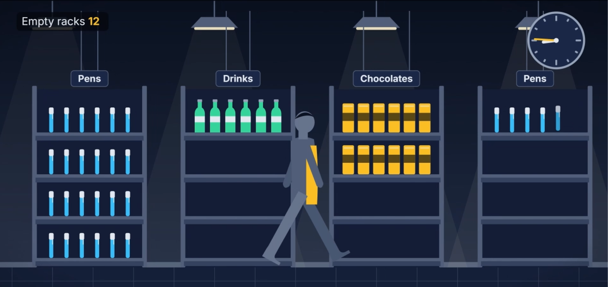
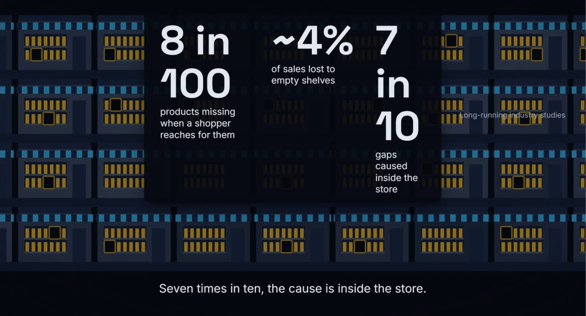
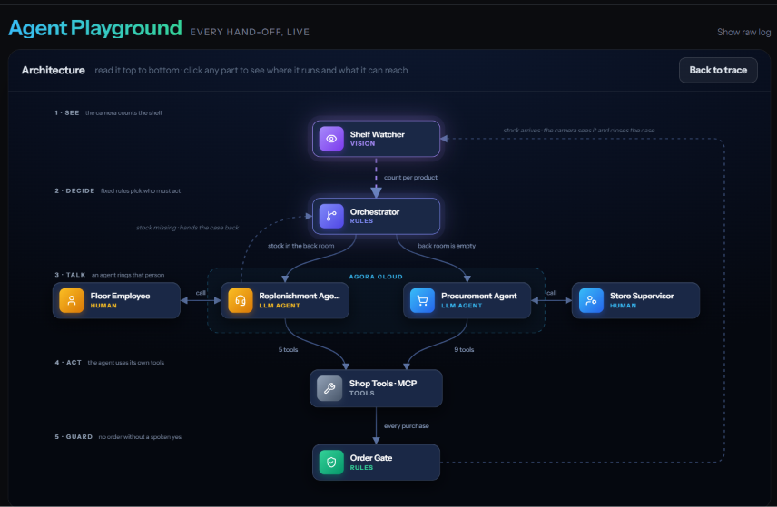
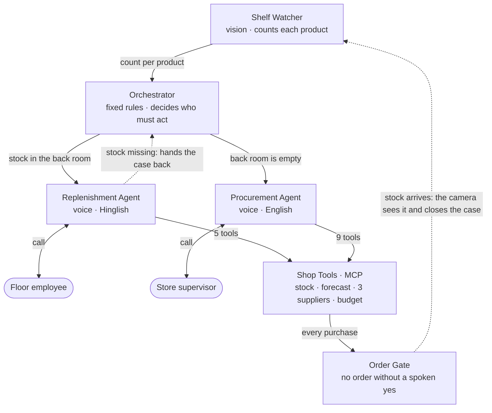
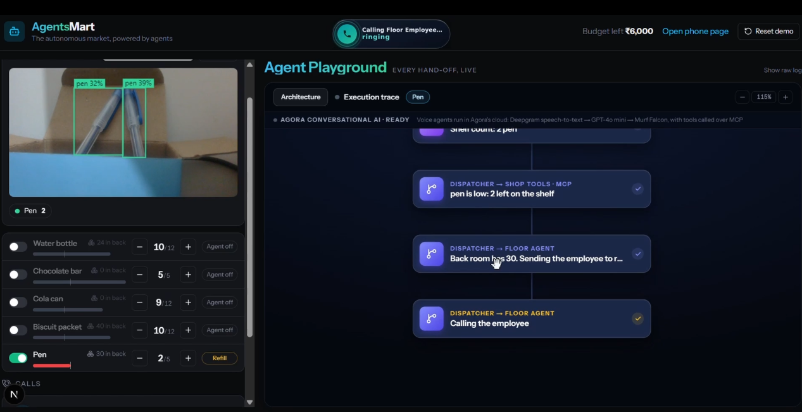
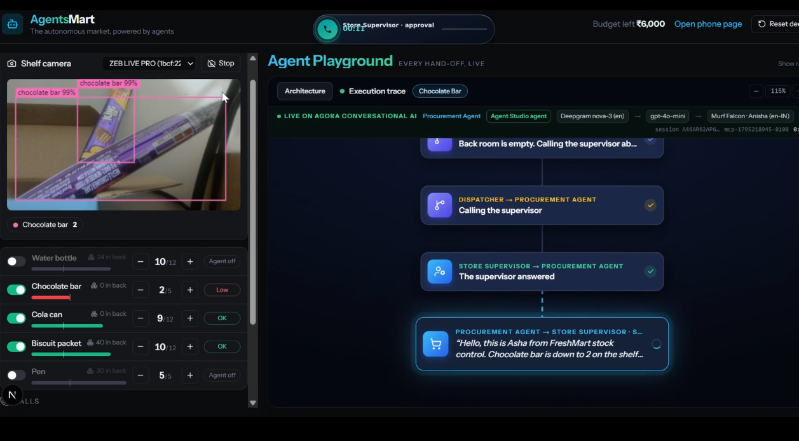

# AgentsMart: the autonomous market, powered by agents

**A supermarket shelf that notices it is running empty, phones the right person, and gets itself refilled or reordered.**

A camera counts the shelf. When a product runs low, an orchestrator decides who must act, and a voice agent named **Asha** makes a real call: to the floor employee in Hinglish if stock is in the back room, or to the supervisor in English with supplier quotes if it is not. No order is placed without a spoken yes.

[](https://www.youtube.com/watch?v=1zRuy7lA2xI)

**▶ [Watch the demo film on YouTube](https://www.youtube.com/watch?v=1zRuy7lA2xI)**

Built solo for **Build with Agora – BLR** (KNOTiC × Agora × Murf AI), **Track 3: AI Agents That Get Things Done**.

## At a glance

| | |
|---|---|
| **Problem** | Shelves go empty while stock sits in the back room, or nobody reorders in time. The shop loses the sale. |
| **Solution** | Agents that see the gap, decide who should act, call that person, and finish the job with tools. |
| **Agents** | Shelf Watcher (vision), Orchestrator (rules), Replenishment Agent (voice), Procurement Agent (voice), Order Gate (guardrail) |
| **Voice** | Agora Conversational AI Engine, Deepgram nova-3 speech-to-text, GPT-4o mini, **Murf Falcon** text-to-speech (voice Anisha, `en-IN` and `hi-IN`) |
| **Tools** | 12 tools served over **MCP** from the same backend; each agent can reach only its own set |
| **Human in the loop** | Every purchase is read back and needs a clear spoken yes; six further checks guard every order |
| **Follow-up** | Promised callbacks really ring; the camera confirms a refill or delivery by sight and closes the case |
| **Stack** | Python FastAPI + FastMCP + SQLite, Next.js + TypeScript, YOLO-World + CLIP running locally |
| **Tests** | 59 automated backend tests |
| **Status** | Working end to end; demo film linked above |

## The problem



Retail studies of out-of-stocks (Gruen and Corsten, *Retail Out-of-Stocks: A Worldwide Examination*) report roughly 8 in 100 products missing from the shelf, about 4% of sales lost, and around 7 in 10 of those gaps caused inside the store: the stock exists, but it was not moved or not ordered in time.

A threshold alert can say a shelf is low. It cannot decide who should act, check the back room, find that the cheapest supplier is out, fit an order to the budget, or change the order when the supervisor says "too much, make it half". Asha does each of those with tools, out loud, and shows every step on screen.

## How it works





| Step | Who | What happens |
|---|---|---|
| 1 · See | **Shelf Watcher** | A webcam frame is analysed on the laptop. A count is believed only after it holds steady for three frames. |
| 2 · Decide | **Orchestrator** | Fixed rules, not a model: is the shelf at or below its low mark, is there already a call, a refill task or an order for it, and does the back room have stock? |
| 3 · Talk | **Replenishment Agent** or **Procurement Agent** | Agora starts a voice agent briefed for that one person and that one product, and rings their phone. |
| 4 · Act | **Shop Tools over MCP** | The agent calls tools during the call. Procurement gathers stock, forecast, quotes and budget **in one turn, four tools in parallel**. |
| 5 · Guard | **Order Gate** | Purchases pass through checks the model cannot skip. |
| After | Orchestrator + Shelf Watcher | Callbacks ring when due. When the camera sees the stock back, the case closes without anyone reporting it. |

### How the Orchestrator routes a low shelf

1. Shelf count above the low mark → nothing to do.
2. Product switched off, a call in progress, an open refill task, or a pending callback → stay quiet.
3. Back room has stock → create a refill task and ring the **employee** (Replenishment Agent).
4. Back room empty and an order already placed → no call.
5. Back room empty and nothing on order → ring the **supervisor** (Procurement Agent).
6. Employee reports the back-room stock is missing → the case goes back to the Orchestrator, which rings the supervisor.

Two rules keep the calls sensible:

- **One call, several products.** When a call is being made anyway, products that are *nearly* low (within 15% of capacity above their low mark) are added to it, so the employee makes one trip and the supervisor approves one combined order.
- **Refill to 80%, not to the brim.** A refill stops at 80% of what the shelf holds, leaving room when a customer puts something back.

## See it working

**Back room has stock: the Replenishment Agent rings the employee.** The camera counts 2 pens, 30 are in the back room, so the employee's phone rings.



**Back room is empty: the Procurement Agent rings the supervisor.** Chocolate bars are down to 2 with none in the back room. The call runs live on Agora with Deepgram, GPT-4o mini and Murf Falcon.



*These two screenshots are from the demo film, recorded before two labels were renamed: "Dispatcher" is now the Orchestrator and "Floor Agent" is now the Replenishment Agent.*

### The demo in two minutes

1. Take chocolate bars off the shelf in front of the camera.
2. The dashboard shows the count drop and the decision: *low, back room empty, calling the supervisor*.
3. The supervisor's phone rings. Asha checks stock, forecast, three suppliers and the budget, and recommends one supplier. The cheapest cannot fill the order.
4. Push back: "order half", "who is fastest?", "keep it under 3,000". She re-prices, reads the total back, and waits.
5. Say yes. The order appears on the dashboard with its number and arrival time.
6. Or say "not now, call me back in a minute". A minute later the phone rings again.
7. Take pens off the shelf. This time the employee's phone rings, in Hinglish, because pens are in the back room. Put pens back and the camera confirms the refill by itself.

## The tools (MCP)

One FastMCP server, mounted at `/mcp` in the backend, called by Agora's cloud during the call. Scope is enforced on the server: a tool outside the caller's role returns `OUT_OF_SCOPE`.

| Tool | What it does | Replenishment | Procurement |
|---|---|:-:|:-:|
| `get_shelf_status` | Shelf and back-room stock | ✓ | ✓ |
| `schedule_callback` | Books a real call back, or a shelf check | ✓ | ✓ |
| `get_refill_tasks` | What needs bringing from the back room | ✓ | |
| `complete_refill_task` | Records a finished refill | ✓ | |
| `report_backroom_shortage` | Stock is missing; escalates to the supervisor | ✓ | |
| `get_sales_rate` | How fast the product sells | | ✓ |
| `get_demand_forecast` | Expected demand before an occasion such as Diwali or Valentine's Day | | ✓ |
| `get_supplier_quotes` | Three suppliers: price, stock, delivery time | | ✓ |
| `get_budget` | Money left to spend | | ✓ |
| `propose_order` | Prices an order and stores it as a proposal | | ✓ |
| `confirm_order` | Places a proposed order, with the supervisor's words | | ✓ |
| `get_order_status` | Orders on their way | | ✓ |

## Guardrails: the Order Gate

The model cannot place an order by deciding to. `propose_order` only stores a proposal and `confirm_order` places it. Between them they refuse when any of these fails:

| Check | Refusal code |
|---|---|
| The supervisor's words are not a clear yes, or contain a no or a wait (English and Hindi) | `APPROVAL_NOT_CLEAR` |
| The proposal is too fresh to have been read aloud | `NOT_READ_OUT` |
| The proposal is older than ten minutes | `PROPOSAL_EXPIRED` |
| The total is over the remaining budget | `OVER_BUDGET` |
| The supplier no longer has enough stock | `SUPPLIER_SHORT` |
| The supplier's price changed after it was read out | `PRICE_CHANGED` |
| An order for this product is already on its way | `ALREADY_ON_ORDER` |

A changed quantity replaces the old proposal, so a stale one cannot be confirmed. The rules live in [`server/src/shop_db.py`](server/src/shop_db.py) and are covered by tests in [`server/tests/test_tool.py`](server/tests/test_tool.py).

## Hackathon requirements

| Requirement or criterion | Where it is met |
|---|---|
| Agora Conversational AI Engine | Every call is an Agora voice agent, started in [`server/src/agent.py`](server/src/agent.py); the two agents are also saved in Agora Agent Studio ([`studio/`](studio/)) |
| Murf Falcon text-to-speech | The voice on every call, in English and Hinglish |
| Tool calling that performs actions | 12 MCP tools in [`server/src/mcp_server.py`](server/src/mcp_server.py): refill tasks, callbacks, orders |
| Track 3: multi-step reasoning, at least two coordinated tool calls, a completed real-world task | Four tools in parallel, then propose, then confirm; the order is placed and later confirmed by the camera |
| End-to-end journey: before, during, action, after | Camera count before the call, a spoken negotiation, the order or refill, then callbacks and visual confirmation |
| Approval before critical actions | The Order Gate above |
| Graceful errors | Every refusal is a plain sentence the agent speaks, with the next best option |
| Multiple agents | Five parts with separate jobs and separate tool scopes |
| MCP | FastMCP server, streamable HTTP, called by Agora's cloud |
| Hinglish | The Replenishment Agent speaks Hinglish to floor staff |
| Visual or physical input | A live shelf camera triggers everything |

## Repository map

| Path | What is in it |
|---|---|
| [`server/src/vision.py`](server/src/vision.py) | Shelf Watcher: finds and counts products in webcam frames |
| [`server/src/dispatch.py`](server/src/dispatch.py) | Orchestrator: routing rules, call queue, refill tasks, callbacks |
| [`server/src/agent.py`](server/src/agent.py) | Starts and stops Agora voice agents |
| [`server/src/prompts.py`](server/src/prompts.py) | What each voice agent is told, greetings, filler phrases |
| [`server/src/mcp_server.py`](server/src/mcp_server.py) | The 12 MCP tools and their per-role scope |
| [`server/src/shop_db.py`](server/src/shop_db.py) | Stock, suppliers, budget, forecast, the Order Gate |
| [`server/src/seasons.py`](server/src/seasons.py) | Store calendar used by the demand forecast |
| [`server/src/call_watch.py`](server/src/call_watch.py) | Captions live calls and rescues an agent that stalls |
| [`server/src/telephony.py`](server/src/telephony.py) | Optional real phone calls through a SIP trunk |
| [`server/tests/`](server/tests/) | 59 tests |
| [`web/src/components/Dashboard.tsx`](web/src/components/Dashboard.tsx) | Shelf, camera, calls, orders |
| [`web/src/components/AgentPlayground.tsx`](web/src/components/AgentPlayground.tsx) | Live trace of every hand-off, and the architecture map |
| [`web/src/components/PhoneApp.tsx`](web/src/components/PhoneApp.tsx) | The phone page that rings |
| [`studio/`](studio/) | Prompts and greetings for the agents saved in Agora Agent Studio |

## Run it

You need Python 3.10+, [Bun](https://bun.sh/), the [Agora CLI](https://github.com/AgoraIO/cli), [ngrok](https://ngrok.com/) with a free static domain, and a [Murf API key](https://murf.ai/api/dashboard).

```bash
bun run setup                               # Python venv + web dependencies
agora login
agora project env write server/.env.local   # Agora App ID and Certificate
```

Add to `server/.env.local`:

```
MURF_API_KEY=your_murf_api_key
MCP_ENDPOINT=https://<your-ngrok-domain>/mcp
PORT=8000
```

Then, in two terminals:

```bash
ngrok http 3000 --url=<your-ngrok-domain>   # one address for web, backend and tools
bun run dev                                 # backend on :8000, web on :3000
```

- Dashboard: `http://localhost:3000`
- Phones: `https://<your-ngrok-domain>/phone`. Pick *Floor employee* on one and *Store supervisor* on the other.

Speech-to-text and the LLM run on Agora-managed credentials, so no other keys are needed. The first run downloads the detector's models (about 480 MB); they are kept out of Git.

Tests:

```bash
cd server && venv/bin/python -m pytest tests -q    # Windows: venv\Scripts\python.exe
```

## The shelf camera

Recognition runs on the laptop, with no cloud vision service.

- An open-vocabulary detector (YOLO-World) is given the catalogue's product names as text, so adding a product is adding a description, with no training.
- Flat wrapped products cannot be named by shape: to the detector a chocolate bar in its wrapper is a "banner". Those go to a second model (CLIP), which reads each object and names the product or rejects it.
- A product is tracked only once it has been seen steadily, so a passing hand or a blurred frame does not ring anyone.

## Where this goes next

- **Real phone numbers.** Dialling mobiles through a Twilio SIP trunk is implemented in `server/src/telephony.py` and switched on with `CALL_MODE=phone`. It has not been run against a live trunk, because that needs a paid account.
- **Real suppliers and stock.** The shop is a local SQLite file; the tools are the seam where a store's inventory system and supplier APIs plug in.
- **Many shelves.** One camera and one orchestrator per aisle, sharing the same tools and the same Order Gate.
- **Learned forecasts.** The occasion uplifts are fixed demo figures today; sales history would replace them.

## Limits

- **Product recognition depends on layout.** It is reliable for bottles, pens and upright chocolate bars with a small gap between them, with the camera close and fixed. Overlapping or distant items are undercounted.
- **One kind of wrapped product on camera.** The reader does not reliably tell a wafer chocolate bar from a biscuit packet, so biscuits are counted by hand on the dashboard.
- **Only products the camera has seen are tracked,** so a product never put in view is never reported empty.
- **Suppliers, stock, budget and occasion uplifts are demo data.**
- **The approval words are passed in by the voice agent.** The gate checks them, but it does not listen to the call audio itself.
- **Hinglish recognition** is Deepgram's multilingual mode and has not been tested in a noisy hall.
- **A count takes a few seconds to settle,** since each frame takes about a second on a laptop processor and three must agree.

## Credits

Started from Agora's [`recipe-agent-mcp`](https://github.com/AgoraIO-Conversational-AI/recipe-agent-mcp) starter, which provided the token service, the agent start/stop calls and the in-call screen. Everything about the shop, the calls, the orchestration, the camera and the dashboard was built for this hackathon.

MIT licensed. See [LICENSE](./LICENSE).
